<p align="center">
  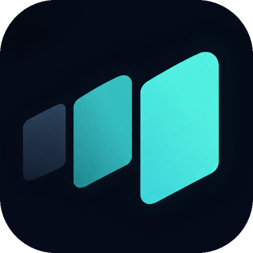
</p>

<h1 align="center">Flowra</h1>

<p align="center">Voice typing for Windows. Hold a key, speak, and your words appear where you type.</p>

<p align="center">
  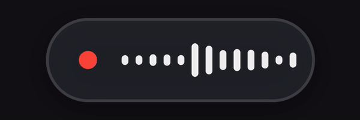
</p>

<p align="center">
  <a href="https://github.com/milesARG/flowra/releases/latest"><b>Download for Windows</b></a>
  &nbsp;·&nbsp; MIT licensed &nbsp;·&nbsp; Runs on your PC
</p>

---

## How it works

| | |
|---|---|
| **Hold <kbd>Right Ctrl</kbd>** and speak. Let go to type it. | **Double-tap** to keep listening hands-free. Tap again to finish. |
| <kbd>Esc</kbd> cancels. <kbd>Ctrl</kbd>+<kbd>Alt</kbd>+<kbd>V</kbd> types your last dictation again. | If there's no text field, your words go to the clipboard instead. |

Speech recognition runs on your PC with [faster-whisper](https://github.com/SYSTRAN/faster-whisper) (`large-v3-turbo` on NVIDIA GPUs, `small` on CPU). The model downloads once on first launch. After that, nothing leaves your machine.

## Features

<table>
  <tr>
    <td width="50%">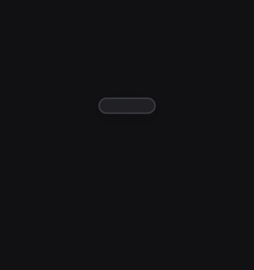<br><b>Hold to talk</b><br>Hold Right Ctrl, speak, then let go.</td>
    <td width="50%">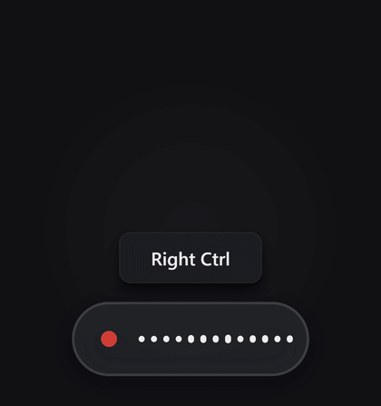<br><b>Hands-free</b><br>Double-tap to lock. A padlock shows it's listening.</td>
  </tr>
  <tr>
    <td>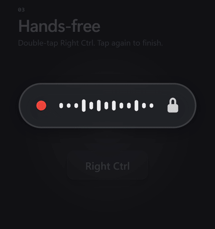<br><b>Clean, corrected text</b><br>Filler words removed. "No wait" corrections applied.</td>
    <td><br><b>Voice commands</b><br>Punctuation, lists and code casing, by voice.</td>
  </tr>
  <tr>
    <td><br><b>Live waveform</b><br>Five themes, any size. Clicks pass straight through it.</td>
    <td><br><b>Local history</b><br>Searchable, and saved only on your PC.</td>
  </tr>
</table>

Also included: custom vocabulary, snippets, per-app rules, drag-to-place indicator with snapping, quiet-speech boost, and start with Windows.

<details>
<summary><b>Voice commands</b></summary>

| Say | Get |
|---|---|
| `new line` · `new paragraph` | Line breaks |
| `bullet point` | `- ` list item |
| `comma` · `colon` · `question mark` … | Punctuation |
| `camel case user name` | `userName` (also snake, kebab, pascal, constant, all caps) |
| `Tuesday, no wait, Friday` | `Friday` |
| `scratch that` | Deletes the last thing Flowra typed |

</details>

## Screenshots

<p>
  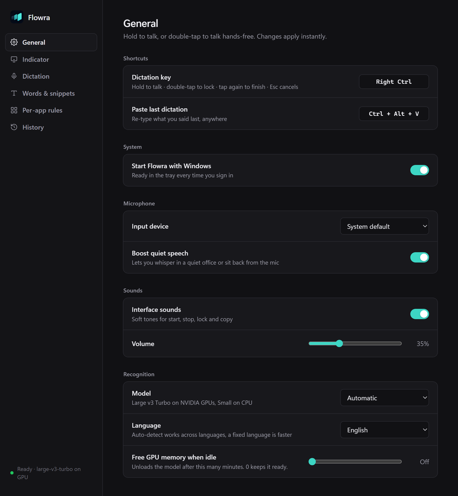
  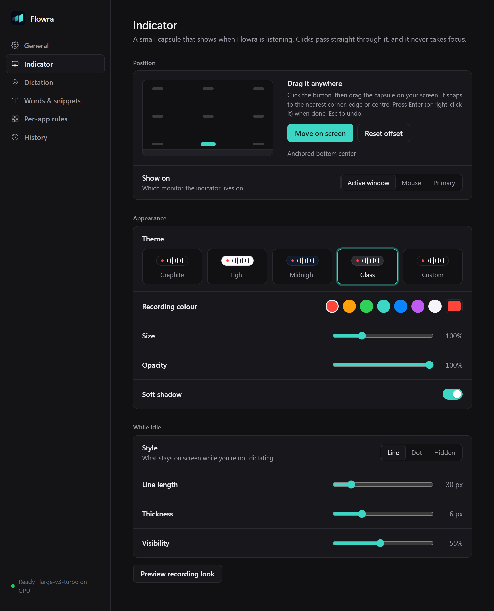
</p>
<p>
  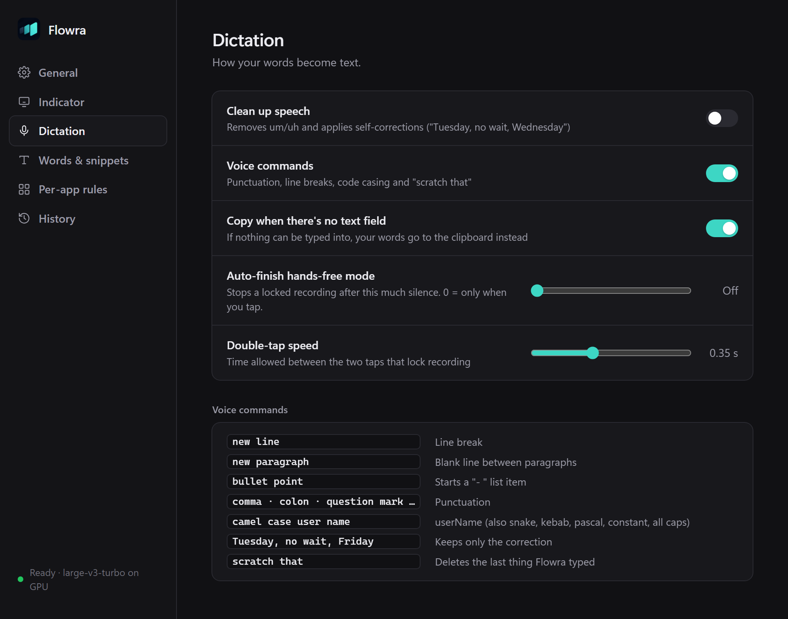
  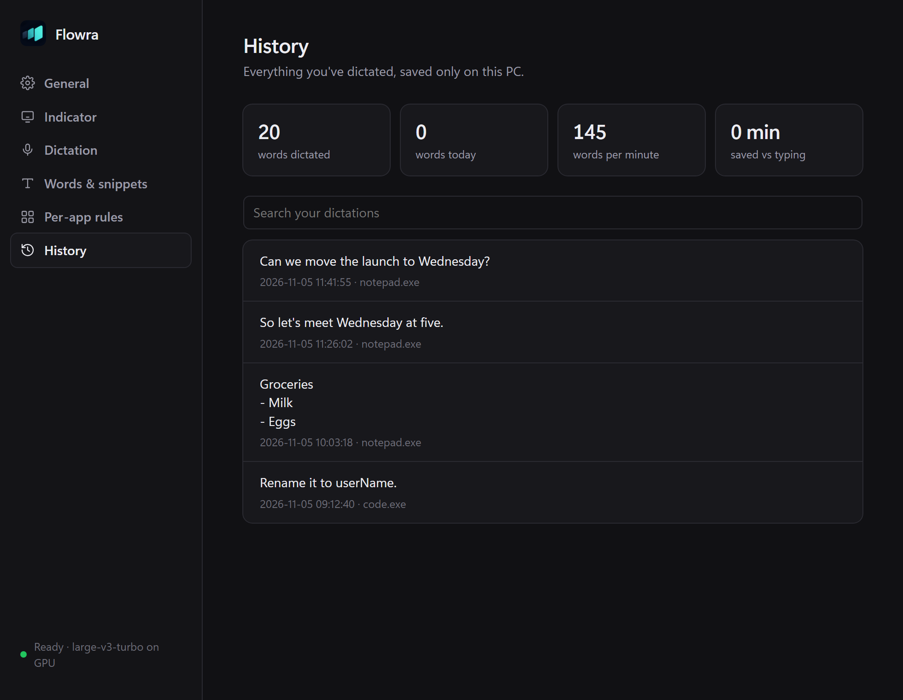
</p>

<details>
<summary>All screenshots (dark and light)</summary>

| | Dark | Light |
|---|---|---|
| General |  | 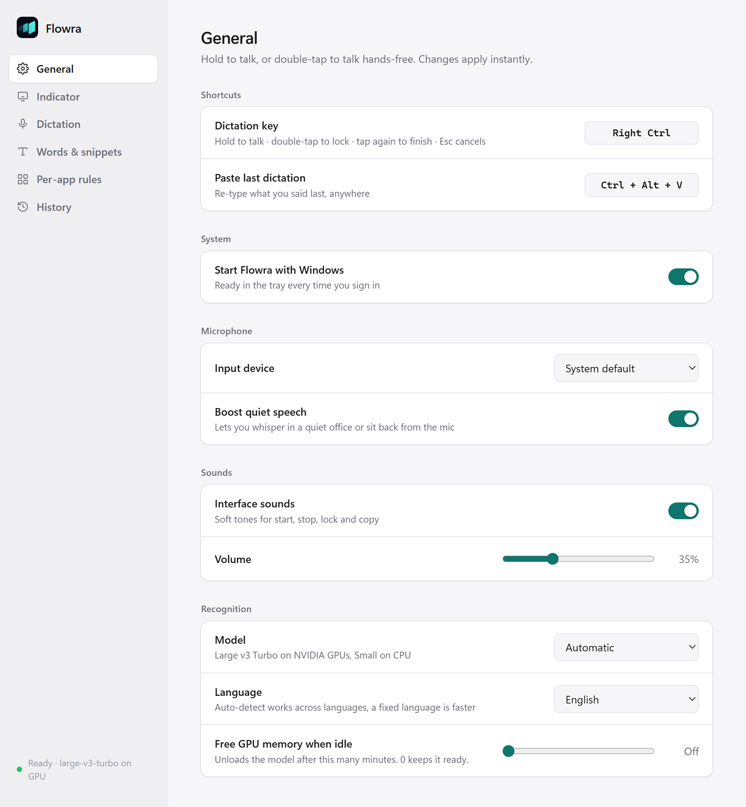 |
| Indicator |  | 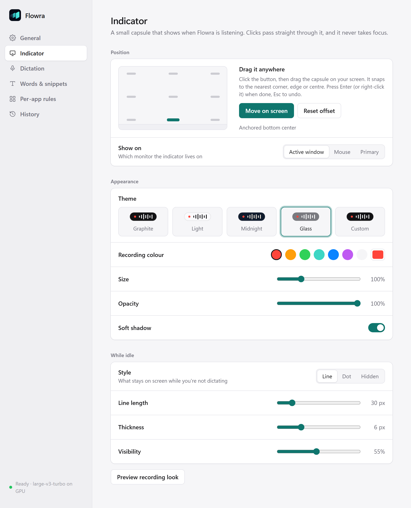 |
| Dictation |  | 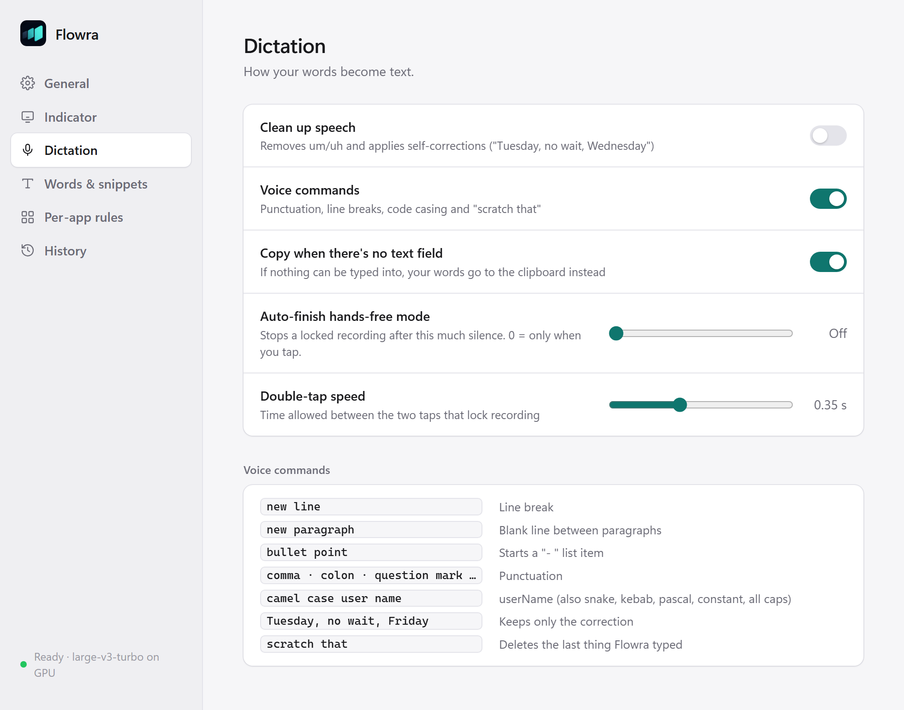 |
| Words & snippets | 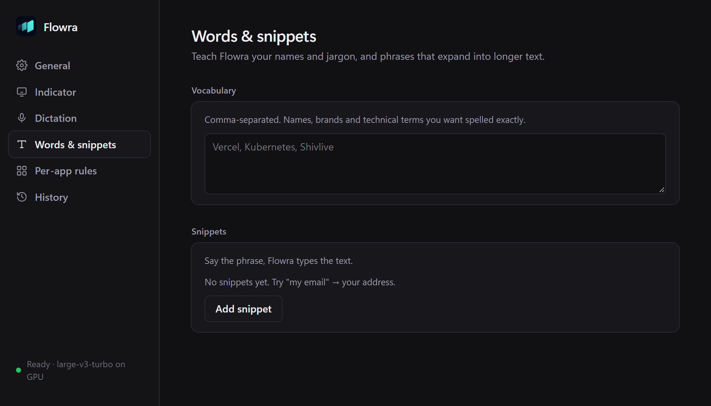 | 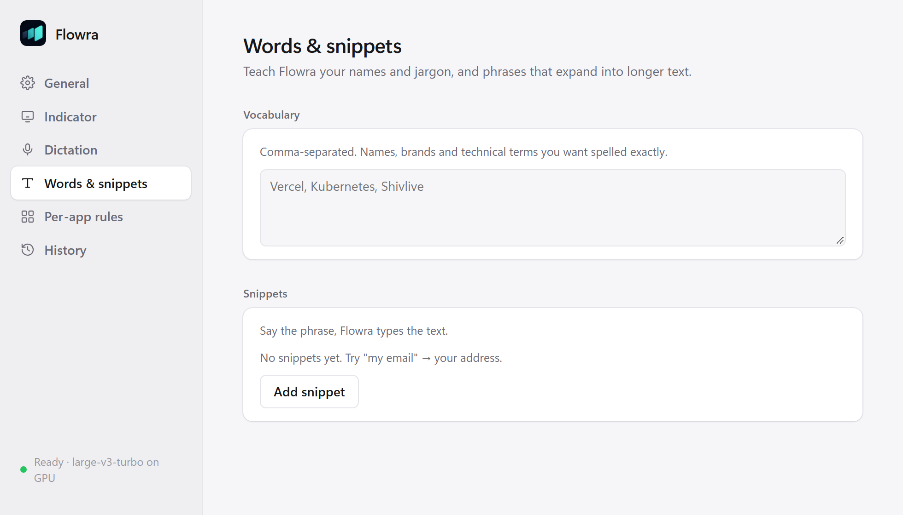 |
| Per-app rules | 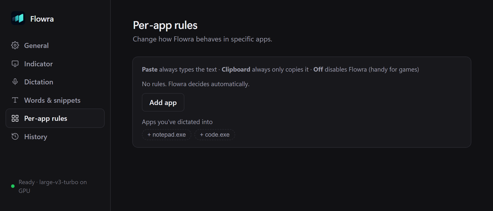 | 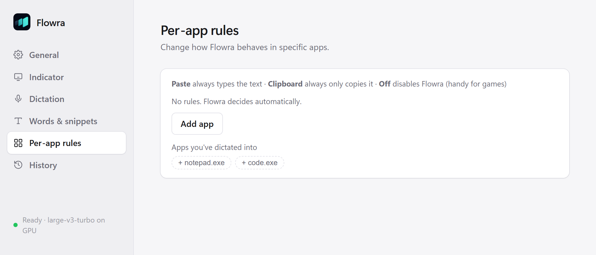 |
| History |  | 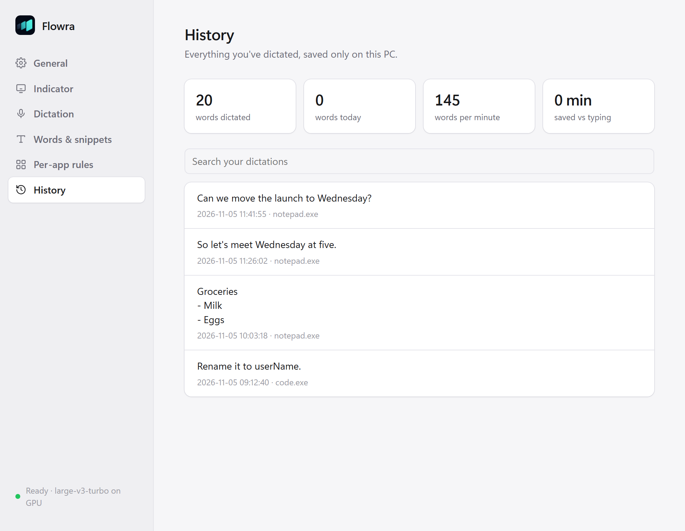 |

Screenshots use demo settings and demo history.

</details>

## Requirements

- Windows 10 or 11, 64-bit
- An NVIDIA GPU is recommended. Flowra falls back to the CPU without one (slower, smaller model).
- About 1.6 GB for the speech model on first launch (about 0.5 GB on CPU)

## Run from source

```powershell
python -m venv .venv
.venv\Scripts\pip install -r requirements.txt
.venv\Scripts\python flowra.py
```

Settings and history are stored next to the code when run from source, and in `%APPDATA%\Flowra` when installed.

## Build the installer

```powershell
.venv\Scripts\pyinstaller flowra.spec --noconfirm
& "$env:LOCALAPPDATA\Programs\Inno Setup 6\ISCC.exe" installer.iss
```

This produces `installer\Flowra-Setup-1.0.0.exe`, a per-user install with no admin prompt. The build is unsigned, so Windows SmartScreen will ask for confirmation.

## Project layout

```
flowra.py            app: hotkeys, recording, transcription, text clean-up, paste
overlay.py           the on-screen indicator (layered, click-through window)
target.py            decides whether to paste or copy (text-field detection)
settings_server.py   local settings window (127.0.0.1, per-run token)
settings.html        settings UI
selftest.py          text clean-up tests:  python selftest.py
assets/              logo and icons (make_icons.py rebuilds them)
```

## Install

Download `Flowra-Setup-1.0.0.exe` from [Releases](https://github.com/milesARG/flowra/releases/latest) and run it. The installer is unsigned, so on the SmartScreen prompt choose **More info → Run anyway**. Flowra then appears in the system tray.

## License

[MIT](LICENSE). Third-party components are listed in [THIRD_PARTY_NOTICES.txt](THIRD_PARTY_NOTICES.txt).
